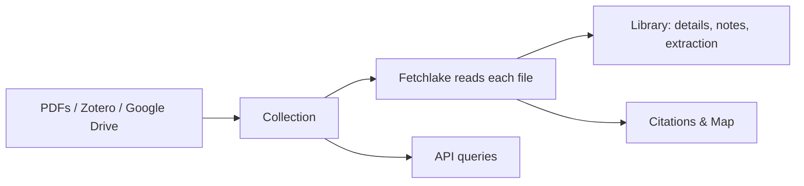

Fetchlake Research is where you keep the papers, reports and policy documents for a piece of research. You add PDFs (or sync them from Zotero or Google Drive), Fetchlake reads them, and you get a searchable library with extracted findings, citations and a map of how the papers relate.

## What's in it

<CardGroup cols={2}>
  <Card title="Library" icon="books" href="/research/library">
    The main workspace. Add files, search and filter, read PDFs with notes, and check the AI-extracted details for each paper.
  </Card>
  <Card title="Collections" icon="folder-open" href="/research/collections">
    Group papers by project or topic. Each collection has its own settings and can be private or public.
  </Card>
  <Card title="Citations and Map" icon="diagram-project" href="/research/citations-and-map">
    See which works your papers cite most, and a timeline or network of how your papers connect.
  </Card>
  <Card title="Connectors" icon="plug" href="/research/connectors">
    Bring in PDFs from Zotero or a Google Drive folder and keep them in sync.
  </Card>
</CardGroup>

## How the pieces fit

1. **Add** files to a collection, by upload or through a connector.
2. **Processing** runs in the background: text is pulled out of each PDF, split into searchable passages, and the paper's details are filled in.
3. **Extraction** pulls the study details (design, sample, outcomes, findings) into a structured record you can check and correct.
4. **Use** the results in the Library, the citation views, or through the [API](/api-reference/introduction).

## Where to find things

| You want to… | Go to |
|---|---|
| Add or read papers | **Dashboard → Library** |
| Create or edit a collection | **Dashboard → Collections** |
| Connect Zotero or Google Drive | **Dashboard → Tools → Connectors** |
| Check credits and plan | **Dashboard → Usage** and **Manage Plan** |
| Create API keys | **Dashboard → API Keys** |
| Screen papers for a systematic review | **Dashboard → Systematic Review** (opens [Huxley](/huxley/overview)) |

## Getting the most out of it

<AccordionGroup>
  <Accordion title="One collection per question">
    Keep a collection focused on one research question or project. Citation counts, the map and API answers are all worked out per collection, so a focused collection gives clearer results.
  </Accordion>
  <Accordion title="Check the extraction, don't just trust it">
    AI extraction is a first draft. Open each paper's record, check the fields against the PDF in the reader, and fix anything wrong. Papers marked **Needs review** are the ones to look at first.
  </Accordion>
  <Accordion title="Use notes as you read">
    The reader saves notes automatically next to each PDF. Writing a line or two per paper as you go makes writing up much faster later.
  </Accordion>
  <Accordion title="Screen first, then build the library">
    For a systematic review, screen titles and abstracts in [Huxley](/huxley/overview) first, then add only the included papers to a collection here.
  </Accordion>
</AccordionGroup>
